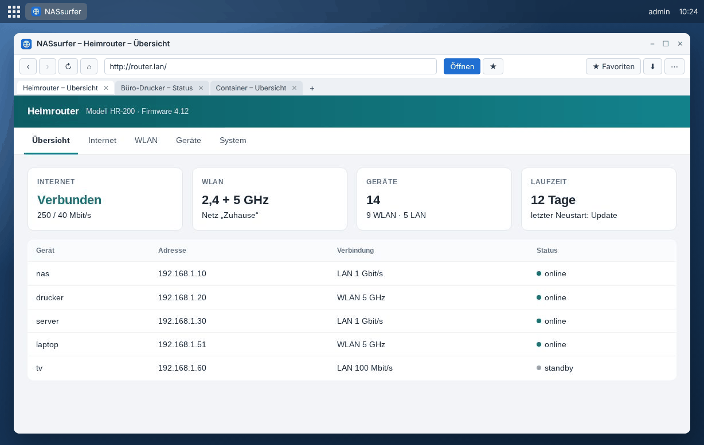
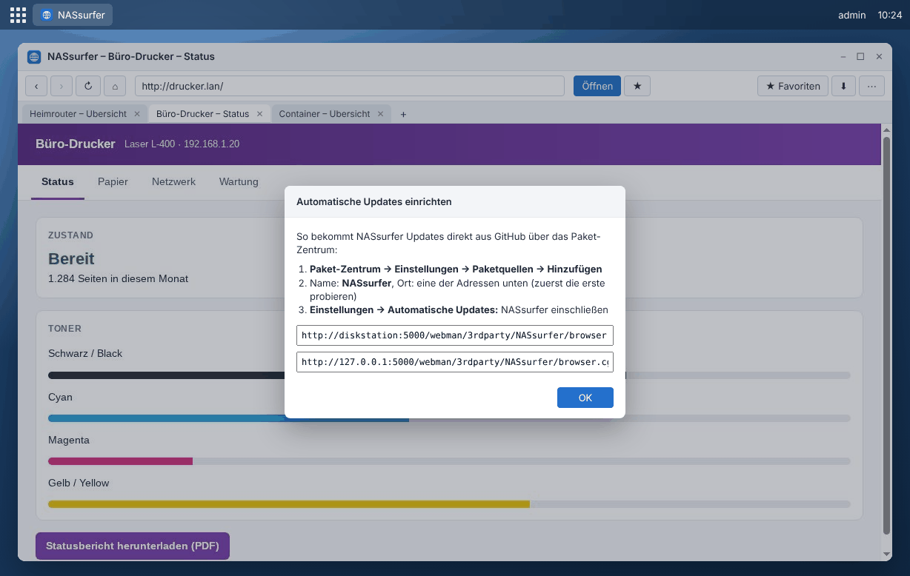
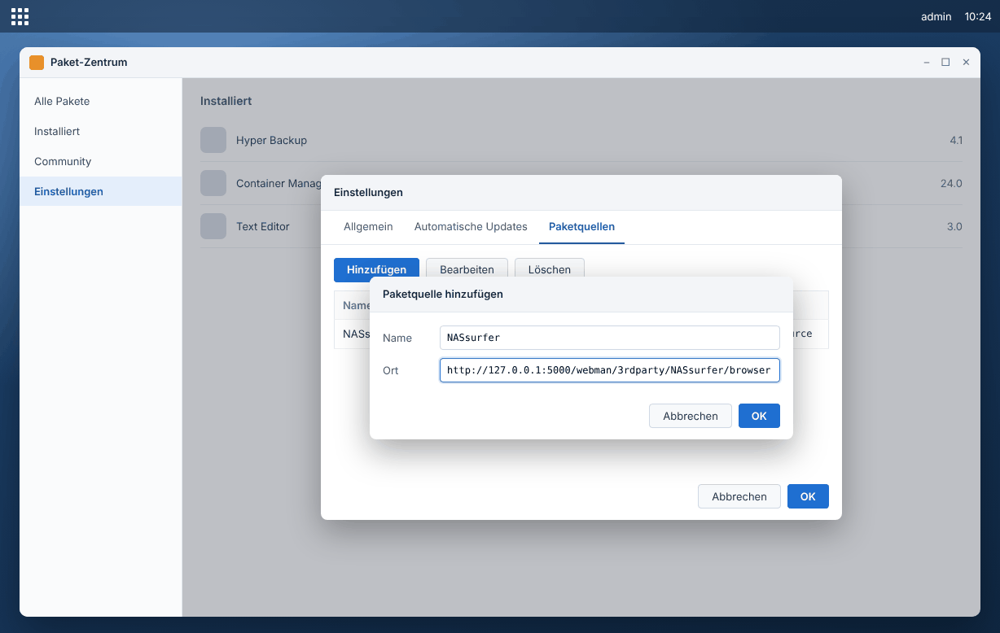
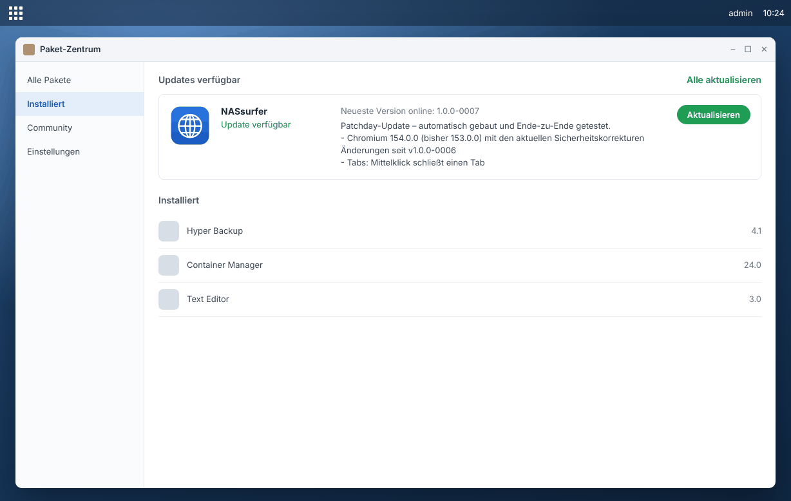
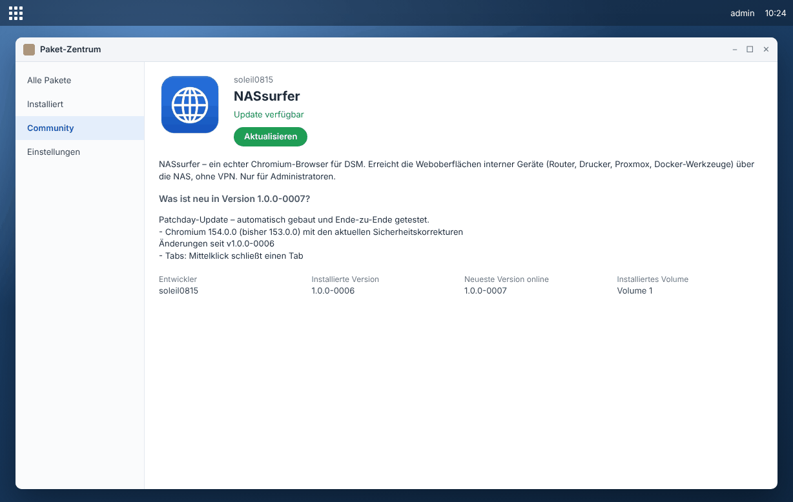
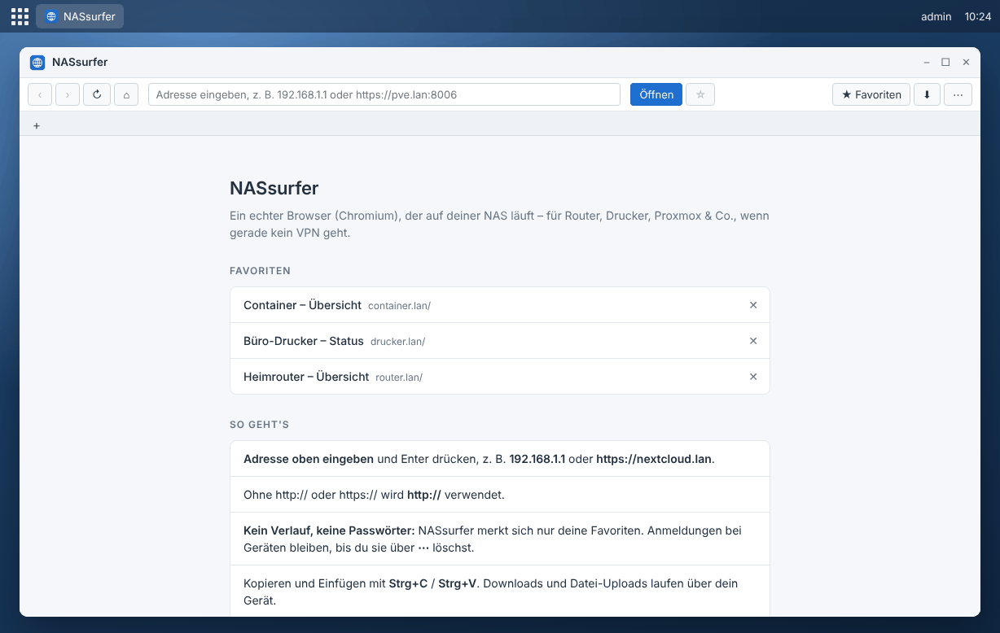
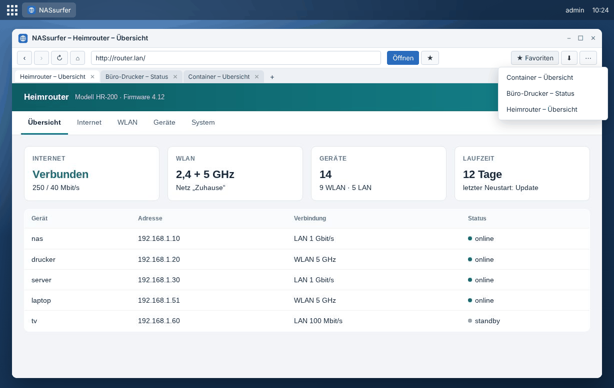
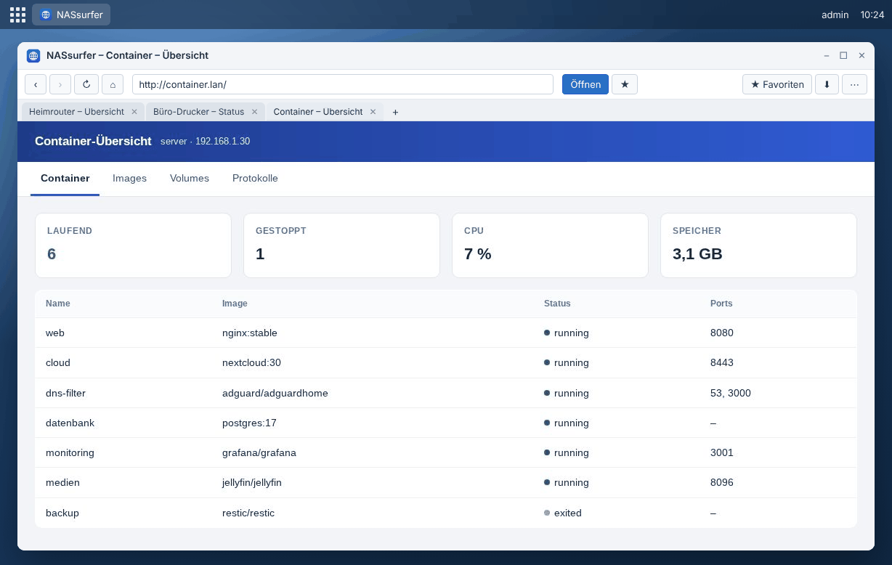
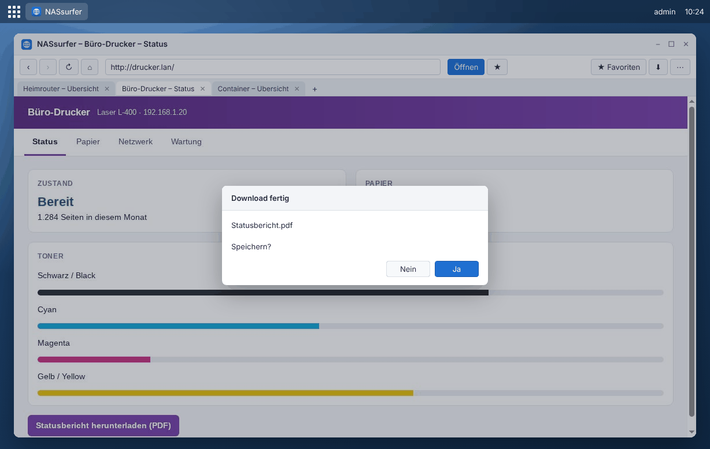

# NASsurfer – ein echter Chromium-Browser für Synology DSM

[English](README.md) · **Deutsch**

[](LICENSE)


[](https://github.com/soleil0815/nassurfer/actions/workflows/build.yml)

NASsurfer ist ein Paket für Synology DSM, das einen **echten Chromium-Browser auf der NAS**
laufen lässt und ihn in einem normalen DSM-Fenster zeigt. Wenn du unterwegs bist und
**kein VPN geht**, meldest du dich wie gewohnt bei DSM an und kommst trotzdem an die
Weboberflächen in deinem Netz: Router, Drucker, Proxmox, Docker-Werkzeuge, Intranet.



<sub>Bilder: echtes NASsurfer-Paket mit echtem Chromium; der DSM-Schreibtisch drumherum und die Geräte sind für die Bilder nachgestellt. [So entstehen sie](#bilder)</sub>

- ein echter Browser: moderne Web-Apps, Konsolen, Live-Grafiken und WebSockets
  funktionieren, weil nichts umgeschrieben wird
- **kein Docker**, kein Container Manager – nur ein Paket
- läuft auf **DSM 7.0, 7.1 und 7.2** (Intel/AMD, `x86_64`)
- Chromium bringt eigene Bibliotheken und Schriften mit und ist unabhängig von den
  DSM-Systembibliotheken
- Sprache und Zeitzone richten sich nach **deinem** Browser
- Tabs, Favoriten (auf der NAS gespeichert), Download-Liste
- Kopieren und Einfügen, Downloads, Datei-Uploads und JavaScript-Dialoge funktionieren
- **kein Verlauf, keine Passwörter:** gespeichert werden nur deine Favoriten
- **nur für Administratoren**
- **bekommt Updates:** neue Chromium-Versionen mit Sicherheitskorrekturen kommen über das
  Paket-Zentrum – siehe [Automatische Updates](#automatische-updates)

---

## Installation

1. Die neueste `NASsurfer-x86_64-….spk` unter [Releases](../../releases) herunterladen.
2. In DSM **Paket-Zentrum → Manuelle Installation** öffnen und die Datei wählen.
3. Den Hinweis auf Drittanbieter-Pakete bestätigen.
4. **NASsurfer** im DSM-Hauptmenü öffnen.

Das Paket ist rund 100 MB groß. Jede offene Browser-Sitzung braucht einige hundert MB RAM.

### Automatische Updates

NASsurfer ist **kein einmaliger Download**: Es gibt Updates, vor allem neue
Chromium-Versionen mit Sicherheitskorrekturen (siehe [Updates](#updates)). Damit deine NAS
davon erfährt, trägst du NASsurfer einmal als **Paketquelle** ein. Danach zeigt das
Paket-Zentrum neue Versionen an wie bei jedem anderen Paket und installiert sie auf Wunsch
auch selbst.

So funktioniert es: Das Paket-Zentrum fragt NASsurfer nach Updates, NASsurfer schaut bei
GitHub nach dem neuesten Release, und das Paket-Zentrum lädt das `.spk` direkt von GitHub.
Kein zusätzlicher Server, kein Konto nötig.

**Einrichten (einmalig, nach der ersten manuellen Installation):**

1. In NASsurfer **⋯ → Automatische Updates einrichten** öffnen. Dort steht die Adresse,
   meist

   ```
   http://127.0.0.1:5000/webman/3rdparty/NASsurfer/browser.cgi?a=source
   ```

   Hast du den HTTP-Port von DSM geändert, ersetze `5000` durch deinen Port.

   
2. **Paket-Zentrum → Einstellungen → Paketquellen → Hinzufügen**: Name `NASsurfer`, Ort:
   diese Adresse → **OK**.

   
3. Optional: **Paket-Zentrum → Einstellungen → Automatische Updates** – NASsurfer
   einschließen, dann werden Updates ohne Klick installiert.

Gibt es eine neue Version, zeigt das Paket-Zentrum sie unter **Updates verfügbar** an:

| Update verfügbar | Paketdetails |
|---|---|
|  |  |

Gut zu wissen:

- Neue Releases erscheinen im Paket-Zentrum nach spätestens etwa einer Stunde (GitHub wird
  höchstens einmal pro Stunde gefragt, das Paket-Zentrum speichert zusätzlich zwischen).
- Nimmt das Paket-Zentrum die `127.0.0.1`-Adresse nicht an, nimm die Adresse, mit der du
  DSM öffnest, z. B. `https://deine-nas:5001/webman/3rdparty/NASsurfer/browser.cgi?a=source`.
- Die Quelle antwortet nur Intel/AMD-Modellen mit DSM 7 und gibt nur öffentliche Angaben
  zum Release weiter. Sie funktioniert ohne Anmeldung, auch wenn NASsurfer gestoppt ist.
- Ohne Paketquelle geht es auch von Hand: das neue `.spk` unter [Releases](../../releases)
  laden und per **Manuelle Installation** installieren – Einstellungen und Favoriten
  bleiben erhalten.

## Bedienung

| Startseite mit Favoriten | Favoriten-Menü |
|---|---|
|  |  |
| **Container-Übersicht im Tab** | **Download von einem Gerät** |
|  |  |

- Adresse in die Adressleiste eingeben, z. B. `192.168.1.1` oder `https://pve.lan:8006`.
  Ohne `http://` oder `https://` wird `http://` verwendet.
- **Strg+C / Strg+V** kopieren und fügen zwischen NASsurfer und deinem Rechner ein
  (auf dem Mac: **Cmd+C / Cmd+V**).
- **Tabs:** `+` öffnet einen neuen Tab, `✕` (oder ein Klick mit dem Mausrad) schließt ihn.
  Links, die ein neues Fenster öffnen, erscheinen als neuer Tab. Bis zu 12 Tabs.
- **Favoriten:** `☆` merkt sich die aktuelle Seite, `★ Favoriten` listet sie auf. Sie
  stehen auch auf der Startseite. Favoriten liegen pro DSM-Benutzer auf der NAS und sind
  deshalb auf jedem Gerät da.
- **Downloads** landen zuerst auf der NAS; NASsurfer fragt dann, ob du sie auf deinem
  Gerät speichern willst. `⬇` listet die Downloads der aktuellen Sitzung, damit du sie
  erneut speichern kannst. Datei-Uploads laufen umgekehrt.
- **Kein Verlauf.** NASsurfer ist als Notfall-Browser gedacht und merkt sich keine
  besuchten Seiten: Der Verlauf von Chromium ist abgeschaltet, und Verlauf, Sitzungen,
  Vorschläge und Zwischenspeicher werden jedes Mal gelöscht, wenn der Browser auf der NAS
  startet oder endet. Eine Liste „Zuletzt geöffnet“ gibt es ebenfalls nicht. Gespeichert
  werden nur deine Favoriten.
- **Passwörter werden nie gespeichert.** Passwort-Manager und Formular-Autofill von
  Chromium sind abgeschaltet, und eventuelle Passwort-/Formulardaten werden bei jedem
  Start gelöscht. Anmelde-Cookies bleiben, damit du angemeldet bleibst; **⋯ → Anmeldungen
  löschen** entfernt das komplette Browser-Profil (Favoriten bleiben).
- Nach **15 Minuten** ohne Nutzung beendet sich der Browser auf der NAS und gibt den
  Speicher frei. Ist das NASsurfer-Fenster noch offen, wird beim Weitermachen die letzte
  Seite wieder geladen.

## So funktioniert es

```
DSM-Fenster (Canvas, Tastatur)  ──►  browser.cgi (prüft die DSM-Anmeldung, stellt ein Token aus)
                                         │  127.0.0.1:47391
                                         ▼
                              nassurfer daemon  ──►  Chromium (DevTools-Protokoll über eine Pipe)
```

- `browser.cgi` prüft die DSM-Anmeldung und stellt ein Token aus, das 8 Stunden gilt.
- Der Dienst prüft jedes Token noch einmal und startet pro DSM-Benutzer einen Chromium
  mit eigenem Profil.
- Das Bild kommt als JPEG-Strom, nur wenn sich etwas ändert. Eingaben gehen in kleinen
  Paketen zurück.

## Sicherheit

- Nur Mitglieder der Gruppe **administrators** können NASsurfer benutzen. Ein Browser auf
  der NAS erreicht alles, was die NAS erreicht.
- Der Dienst lauscht nur auf `127.0.0.1`; Chromium wird über eine Pipe gesteuert, nicht
  über einen offenen Debug-Port.
- Chromium läuft unter dem eigenen, eingeschränkten Paket-Benutzer. DSM erlaubt die
  Namensräume nicht, die Chromiums eigene Sandbox braucht; Chromium läuft deshalb mit
  `--no-sandbox`.
- Zertifikatsfehler werden bewusst ignoriert: Geräte im eigenen Netz haben fast immer
  selbst signierte Zertifikate.
- Chromium braucht regelmäßige Sicherheitsupdates – halte das Paket aktuell.

## Updates

- Jeder Release wird von GitHub Actions gebaut und **Ende-zu-Ende getestet**, bevor das
  Paket angehängt wird: Das `.spk` wird wie auf DSM installiert, mit dem DSM-Startskript
  gestartet und im Browser geprüft (Tippen, Zwischenablage, Dialoge, Tabs, Downloads,
  Uploads, Favoriten, Sprache und dass kein Passwort im Profil landet).
- **Patchday:** Am zweiten Dienstag im Monat prüft ein Workflow, ob es einen neueren
  Chromium gibt. Wenn ja, baut, testet und veröffentlicht er automatisch einen neuen
  Release – nur wenn alle Tests bestehen.

## Bilder

Die Bilder in dieser README entstehen mit `tools/screenshots/run.sh`: Das Skript installiert
das echte `.spk`, startet den echten Dienst samt Chromium und öffnet das echte
Fenster-Skript. Nur der DSM-Schreibtisch und das Paket-Zentrum drumherum sind vereinfacht
nachgebaut (keine Software von Synology), und die Geräte (Router, Drucker, Container) sind
ausgedacht. Die Update-Einträge kommen live aus der NASsurfer-Paketquelle.

```sh
sudo tools/screenshots/run.sh dist/NASsurfer-x86_64-<version>.spk   # → docs/images/{de,en}
```

## Bauen

```sh
tools/prepare-chromium.sh build/chromium   # Chromium + Bibliotheken + Schriften, fest auf den Paketpfad verdrahtet
./build.sh                                 # → dist/NASsurfer-x86_64-<version>.spk
```

Benötigt: Go, npm, python3 mit `brotli`, `patchelf`, `apt-get download` (Ubuntu/Debian).

Ende-zu-Ende-Test eines gebauten Pakets (braucht root für `/var/packages`, Google Chrome
und python3 mit `playwright`):

```sh
test/e2e/run.sh dist/NASsurfer-x86_64-<version>.spk
```

## Bekannte Grenzen

- Nur `x86_64` (Intel/AMD). Chromium-Builds für ARM-NAS-Modelle gibt es hier nicht.
- Das Bild wird in normaler Auflösung übertragen und kann auf hochauflösenden
  Bildschirmen leicht unscharf wirken.
- Es fühlt sich an wie eine Fernsteuerung: Es gibt eine kurze Verzögerung, besonders
  über langsame Verbindungen.

## Haftungsausschluss

Ich habe NASsurfer in erster Linie für meinen eigenen Einsatz gebaut und nutze es selbst.
Wer es verwendet, tut das in eigener Verantwortung.

NASsurfer steht in keiner Verbindung zu Synology Inc. oder Google LLC.

## Lizenz

Der eigene Code von NASsurfer steht unter der [GNU Affero General Public License v3.0](LICENSE)
(AGPL-3.0-only). Du darfst ihn nutzen, verändern und weitergeben. Wer eine veränderte
Version weitergibt oder anderen über ein Netzwerk anbietet, muss den Quellcode unter
derselben Lizenz offenlegen.

Das Paket enthält außerdem Fremdsoftware unter eigenen Lizenzen, siehe
[THIRD_PARTY_NOTICES.md](THIRD_PARTY_NOTICES.md).
