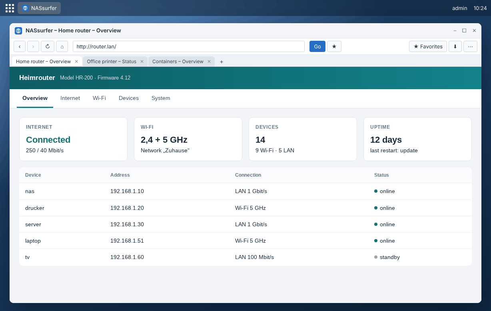
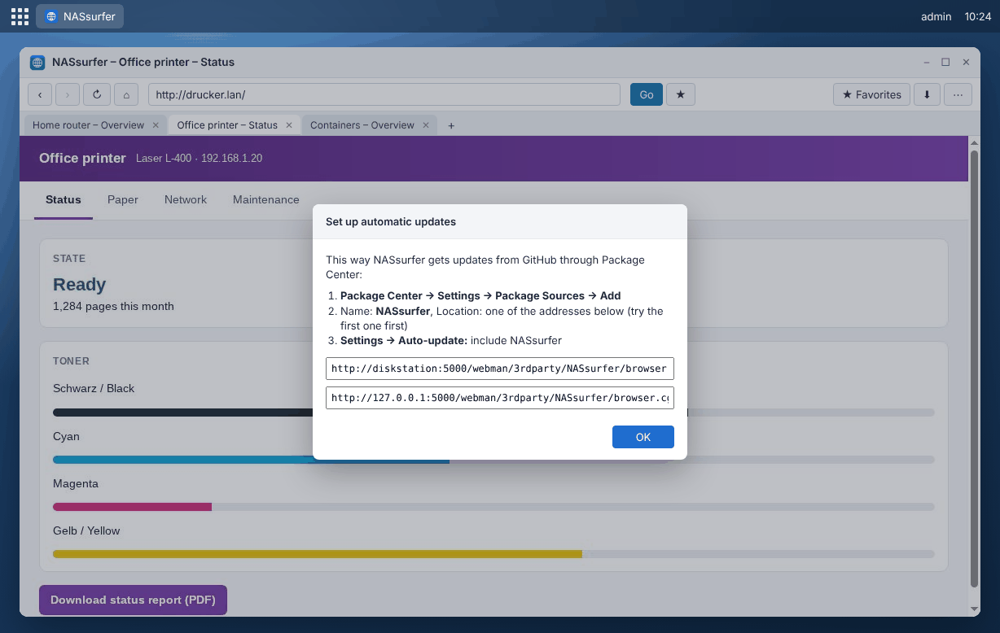
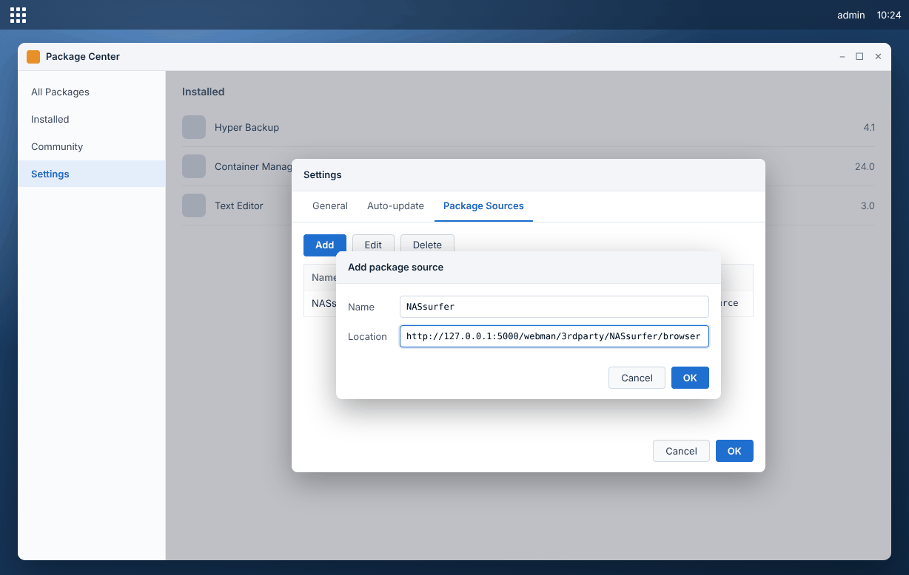
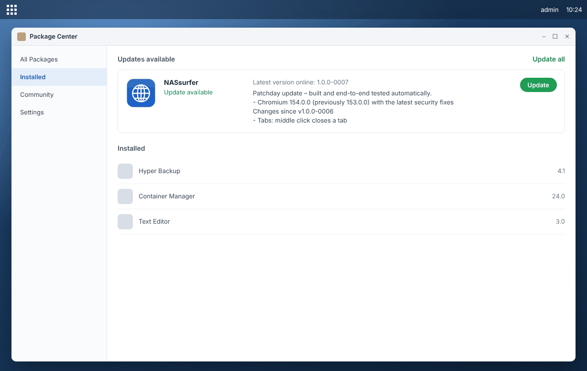
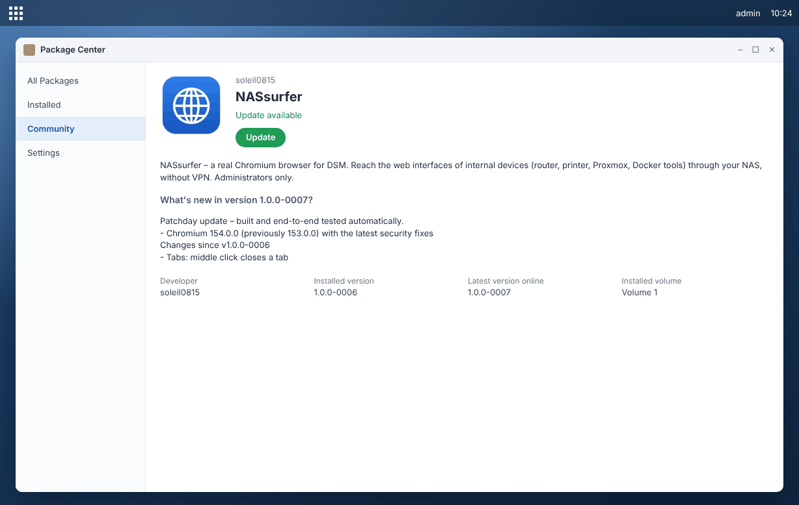
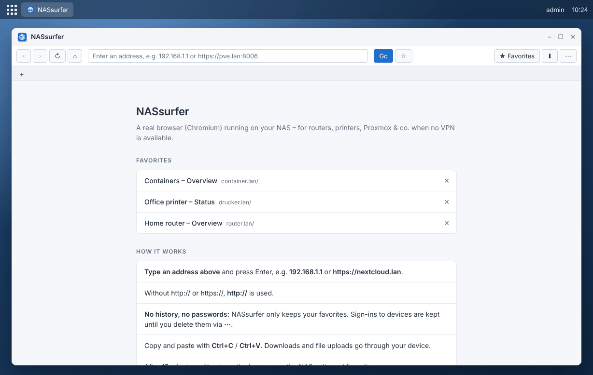
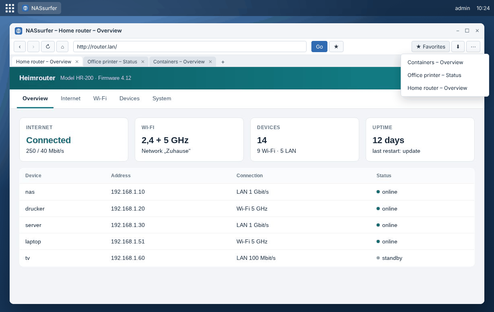
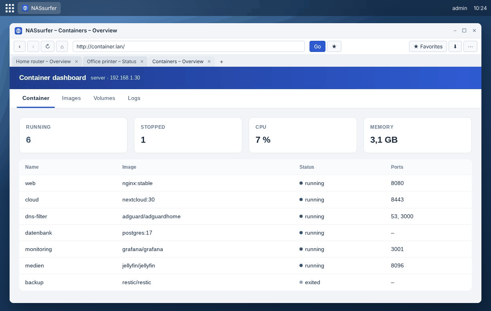
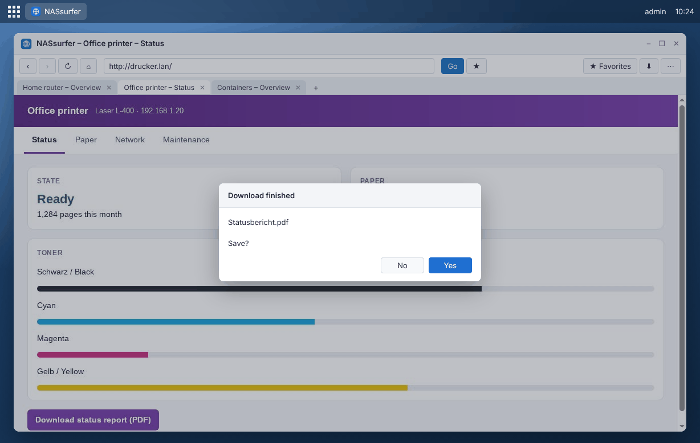

# NASsurfer – a real Chromium browser for Synology DSM

**English** · [Deutsch](README.de.md)

[](LICENSE)


[](https://github.com/soleil0815/nassurfer/actions/workflows/build.yml)

NASsurfer is a package for Synology DSM that runs a **real Chromium browser on your NAS**
and shows it in a normal DSM window. When you are away and **no VPN is available**, you
sign in to DSM as usual and can still reach the web interfaces inside your network:
router, printer, Proxmox, Docker tools, intranet pages.



<sub>Pictures: the real NASsurfer package and Chromium; the DSM desktop around it and the devices are recreated for the pictures. [How they are made](#screenshots)</sub>

- a real browser: modern web apps, consoles, live charts and WebSockets work, because
  nothing is rewritten
- **no Docker**, no Container Manager – just a package
- runs on **DSM 7.0, 7.1 and 7.2** (Intel/AMD, `x86_64`)
- Chromium brings its own libraries and fonts and does not depend on DSM's system libraries
- language and time zone follow **your** browser
- tabs, favorites (stored on the NAS), downloads list
- copy & paste, downloads, file uploads and JavaScript dialogs work
- **no history, no passwords:** only your favorites are kept
- **administrators only**
- **receives updates:** new Chromium versions with security fixes arrive through Package
  Center – see [Automatic updates](#automatic-updates)

---

## Installation

1. Download the latest `NASsurfer-x86_64-….spk` from the
   [Releases](../../releases) page.
2. In DSM open **Package Center → Manual Install** and choose the file.
3. Confirm the notice about third-party packages.
4. Open **NASsurfer** from the DSM main menu.

The package is about 100 MB. Each open browser session uses a few hundred MB of RAM.

### Automatic updates

NASsurfer is **not a one-off download**: it gets updates, above all new Chromium versions
with security fixes (see [Updates](#updates)). So that your NAS notices them, add NASsurfer
as a **package source** once. After that Package Center shows new versions like any other
package and, if you want, installs them automatically.

How it works: Package Center asks NASsurfer for updates, NASsurfer looks up the newest
release on GitHub, and Package Center downloads the `.spk` straight from GitHub. No extra
server or account is needed.

**Setup (once, after the first manual install):**

1. In NASsurfer open **⋯ → Set up automatic updates**. It shows the address to use,
   usually

   ```
   http://127.0.0.1:5000/webman/3rdparty/NASsurfer/browser.cgi?a=source
   ```

   If you changed DSM's HTTP port, replace `5000` with your port.

   
2. **Package Center → Settings → Package Sources → Add**: name `NASsurfer`, location: that
   address → **OK**.

   
3. Optional: **Package Center → Settings → Auto-update** – include NASsurfer, then updates
   are installed without a click.

When a new version is out, Package Center shows it under **Updates available**:

| Update available | Package details |
|---|---|
|  |  |

Good to know:

- New releases show up in Package Center within about an hour (GitHub is asked at most
  once per hour, Package Center also caches).
- If Package Center does not accept the `127.0.0.1` address, use the address you open DSM
  with, e.g. `https://your-nas:5001/webman/3rdparty/NASsurfer/browser.cgi?a=source`.
- The source answers only Intel/AMD models with DSM 7 and passes on nothing but public
  release information. It works without signing in, even while NASsurfer is stopped.
- Without the package source you can still update by hand: download the new `.spk` from
  [Releases](../../releases) and install it via **Manual Install** – settings and
  favorites are kept.

## Usage

| Start page with favorites | Favorites menu |
|---|---|
|  |  |
| **Container dashboard in a tab** | **Download from a device** |
|  |  |

- Type an address in the address bar, e.g. `192.168.1.1` or `https://pve.lan:8006`.
  Without `http://` or `https://`, `http://` is used.
- **Ctrl+C / Ctrl+V** copy and paste between NASsurfer and your computer
  (on a Mac: **Cmd+C / Cmd+V**).
- **Tabs:** `+` opens a new tab, `✕` (or a middle click) closes it. Links that open a
  new window appear as a new tab. Up to 12 tabs.
- **Favorites:** `☆` saves the current page, `★ Favorites` lists them. They are also shown
  on the start page. Favorites are stored per DSM user on the NAS, so they are available
  on every device.
- **Downloads** are first saved on the NAS; NASsurfer then asks whether to save them on
  your device. `⬇` lists the downloads of the current session so you can save them again.
  File uploads go the other way.
- **No history.** NASsurfer is meant as an emergency browser and keeps no list of visited
  pages: Chromium's history is switched off, and history, sessions, suggestions and cache
  are deleted every time the browser on the NAS starts or quits. There is no "recently
  opened" list either. Only your favorites are kept.
- **Passwords are never stored.** Chromium's password manager and form autofill are
  switched off, and any password/form data is deleted on every start. Sign-in cookies are
  kept so you stay signed in; **⋯ → Delete sign-ins** removes the whole browser profile
  (favorites are kept).
- After **15 minutes** without use the browser on the NAS quits and frees its memory.
  If the NASsurfer window is still open, the last page is loaded again when you continue.

## How it works

```
DSM window (canvas, keyboard)  ──►  browser.cgi (checks the DSM sign-in, issues a token)
                                        │  127.0.0.1:47391
                                        ▼
                             nassurfer daemon  ──►  Chromium (DevTools protocol over a pipe)
```

- `browser.cgi` checks the DSM sign-in and issues a token valid for 8 hours.
- The daemon checks every token again and starts one Chromium per DSM user with its
  own profile.
- The picture is sent as JPEG frames, only when something changes. Input is sent back
  in small batches.

## Security

- Only members of the **administrators** group can use NASsurfer. A browser on the NAS
  can reach everything the NAS can reach.
- The daemon only listens on `127.0.0.1`; Chromium is controlled through a pipe, not
  through an open debugging port.
- Chromium runs as the package's own restricted user. DSM does not allow the namespaces
  Chromium's own sandbox needs, so Chromium runs with `--no-sandbox`.
- Certificate errors are ignored on purpose: devices inside a network almost always use
  self-signed certificates.
- Chromium needs regular security updates – keep the package up to date.

## Updates

- Every release is built by GitHub Actions and **tested end to end** before the package is
  attached: the `.spk` is installed like on DSM, started with the DSM start script and
  tested in a browser (typing, clipboard, dialogs, tabs, downloads, uploads, favorites,
  language, and that no password ends up in the profile).
- **Patchday:** on the second Tuesday of each month a workflow checks for a newer
  Chromium. If there is one, it builds, tests and publishes a new release automatically –
  only if all tests pass.

## Screenshots

The pictures in this README are made with `tools/screenshots/run.sh`: it installs the real
`.spk`, starts the real service and Chromium and opens the real window script. Only the
DSM desktop and Package Center around it are simplified recreations (not Synology's
software), and the devices (router, printer, containers) are made up. The update entries
come live from NASsurfer's package source.

```sh
sudo tools/screenshots/run.sh dist/NASsurfer-x86_64-<version>.spk   # → docs/images/{de,en}
```

## Building

```sh
tools/prepare-chromium.sh build/chromium   # Chromium + libraries + fonts, wired to the package path
./build.sh                                 # → dist/NASsurfer-x86_64-<version>.spk
```

Requirements: Go, npm, python3 with `brotli`, `patchelf`, `apt-get download` (Ubuntu/Debian).

End-to-end test of a built package (needs root for `/var/packages`, Google Chrome and
python3 with `playwright`):

```sh
test/e2e/run.sh dist/NASsurfer-x86_64-<version>.spk
```

## Known limitations

- Only `x86_64` (Intel/AMD). Chromium builds for ARM NAS models are not available here.
- The picture is transferred in normal resolution and can look slightly soft on
  high-DPI screens.
- It feels like a remote session: there is a short delay, especially over slow connections.

## Disclaimer

I built NASsurfer mainly for my own use and use it myself. If you use it, you do so at
your own risk.

NASsurfer is not affiliated with Synology Inc. or Google LLC.

## License

NASsurfer's own code is licensed under the [GNU Affero General Public License v3.0](LICENSE)
(AGPL-3.0-only). You may use, change and share it. If you distribute a modified version
or offer it to others over a network, you must make your source code available under the
same license.

The package also contains third-party software under its own licenses, see
[THIRD_PARTY_NOTICES.md](THIRD_PARTY_NOTICES.md).
